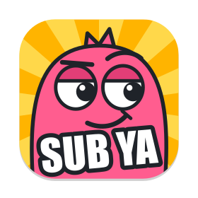

<p align="center">
  
</p>

<h1 align="center">Subya</h1>

<p align="center">Big, readable captions for your memes and reaction clips, made on your Mac.</p>

Subya ("sub ya") is a small macOS app that burns captions into a video clip, so the line
lands even when your friends watch with the sound off, in WhatsApp, Messages or the
group chat.

Drop a video on the window. Subya transcribes it on your Mac and splits the speech
into short caption lines. Fix any wrong words or timings in the list, watch the preview,
then export. You get a new `<name>-captioned.mp4` next to the original, with bold white
captions outlined in black near the bottom of the frame.

Nothing is uploaded. Transcription uses the speech recognition built into macOS, and there
are no permissions to grant.

## Install

Download `Subya.dmg` from the latest release and drag Subya to Applications. It
needs macOS 26 or later.

## Use

1. Drag a video onto the window, or choose **File › Open Video…** (⌘O).
2. Wait a moment while it's transcribed. The first time, macOS may download its speech
   model for your language.
3. Edit the captions on the right. You can change the text, the start and end times
   (in seconds), or delete a line. Click ▶ next to a line to play from there. The line
   that's on screen is highlighted. The timeline under the video works like the trim
   bar in Photos: a filmstrip of the video with every caption as a block on it. Click a
   caption to select it (yellow, with grips), drag it to move it, or drag its edges to
   change when it starts and ends, and the preview follows so you can line it up with
   the exact frame. Click or drag the filmstrip to scrub.
4. To add text nobody says, like a caption over a silent reaction shot, move the
   playhead there and press **+ Line** (⌘N). Videos with no sound at all work too:
   just add your lines.
5. Style the captions with the bar above the list: pick a style (Classic, Meme, Rounded,
   Marker, Typewriter, Poster, Boxed or Highlight), put them at the top, middle or
   bottom, switch all caps on or off, and drag the size slider. To place them anywhere
   in between, drag the captions up or down on the video, or use the handle at its
   right edge; they snap to the top, middle and bottom on the way. Turn on **One word**
   to show each word alone as it's spoken, a punchy look for reaction clips (the
   **One Word** style does this big and centred). In this mode the timeline splits each
   caption into its words: drag the line between two words to change when the second
   one appears. Zoom the timeline in to give words room: use the magnifiers or slider
   by the time, pinch on the timeline, or ⌘+ and ⌘− (⌘0 fits the whole video). When
   zoomed, scroll sideways; the timeline follows the playhead as it plays. The preview updates as
   you go, and Subya remembers your choices.
6. To crop, click **Crop** in the top-left corner of the video panel. Pick a shape (1:1, 9:16 for Stories, 4:5, 16:9,
   the original, or free), drag the frame to move it and its corners to resize it, then
   click **Done**. Captions are placed inside the cropped frame.
7. Click **Export…** (⌘E).

## Settings

Open **Subya › Settings…** (⌘,), or click the brush next to the style picker.

- **Styles:** make your own caption styles. Duplicate one, then pick any font on your
  Mac, the text and outline colours, the outline thickness, a shadow, a box behind the
  text (with see-through colours, if you like), where it sits, its size and caps, and
  whether it shows whole lines or one word at a time. A
  live preview shows each change.
- **General:** the transcription language (for clips not in your Mac's language), how
  captions are split (longest line, the pause that starts a new caption, how long
  captions stay up), and export: where files go, the file name ending, and quality.
  **Smaller for messaging** saves at 720p, which sends faster.

## Command line

The `subya` tool does the same from Terminal:

```sh
swift run subya transcribe clip.mp4 --srt > clip.srt   # edit clip.srt if needed
swift run subya burn clip.mp4 clip-captioned.mp4 --captions clip.srt
```

Without `--captions`, `burn` transcribes first. `--style <name>` picks a style, including
your own from Settings (`subya styles` lists them). `--position top|middle|bottom` (or a number from 0, top, to 1, bottom),
`--caps` or `--no-caps`, `--scale 1.3` (text 30% bigger) and `--words` (one word at a
time) adjust it. `--crop 9:16` (or 1:1, 4:5, 16:9) crops to the centre of the frame. `--small` saves at
720p, and `--language fr-FR` transcribes in another language.

## Development

You need Xcode 26 or later and a Developer ID signing identity. `make dmg` also needs
`create-dmg`, and `make icons` needs Inkscape.

```sh
make run       # build a universal app, sign it, and launch it
make test      # unit tests
make release   # notarized DMG (run `make notary-setup` once first)
make help      # everything else
```

## License

GPL-3.0. See [LICENSE](LICENSE).
