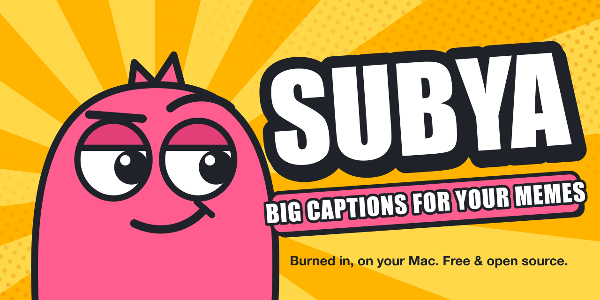

<p align="center">
  
</p>

<p align="center">
  <b>Big, loud, readable captions for your memes and reaction clips. Made on your Mac.</b>
</p>

<p align="center">
  <a href="https://github.com/duggan/Subya/releases/latest/download/Subya.dmg"><b>⬇ Download Subya for Mac</b></a>
  &nbsp;·&nbsp;
  <a href="https://duggan.github.io/Subya/">Website</a>
  &nbsp;·&nbsp;
  <a href="https://github.com/duggan/Subya/releases">All releases</a>
</p>

<p align="center">
  Free and open source · macOS 26 Tahoe or later
</p>

---

Subya ("sub ya", as in *subtitle you*) burns captions right into a video, so the line
lands even when your friends watch with the sound off, in WhatsApp, Messages or the
group chat. Messaging apps drop or hide subtitle tracks; burned-in text always shows.

Drop a clip on the window. Subya transcribes it **on your Mac**, splits the speech into
punchy caption lines, and shows you exactly what you'll get. Fix a word, pick a look,
export. That's it.

<!-- Screenshot: replace with a real one before release, e.g.
<p align="center"></p>
-->

## What it does

- **Transcribes on your Mac.** Apple's on-device speech recognition, no uploads, no
  account, and no permissions to grant.
- **What you see is what you export.** The preview *is* the export, updated as you type.
- **Nine looks, plus your own.** Classic, Meme, Rounded, Marker, Typewriter, Poster,
  Boxed, Highlight and One Word. Make your own with any font on your Mac, colours,
  outline, shadow and a box behind the text.
- **One word at a time.** The punchy reaction-clip look, with each word timed to the
  speech and a word-by-word timeline to nudge them.
- **Put the text anywhere.** Drag captions up and down on the video; they snap to top,
  middle and bottom.
- **A real timeline.** A Photos-style filmstrip with every caption on it: drag to move,
  drag edges to retime, zoom in for the fiddly bits.
- **Say what nobody said.** Add a line at the playhead (⌘N) for silent reaction shots.
  Videos without sound work too.
- **Trim and crop.** Keep just the bit you want (big videos are fine: only the trimmed
  part is transcribed), and crop to 9:16, 1:1, 4:5 or 16:9.
- **Ready for the chat.** Exports an MP4 next to the original, optionally at 720p so it
  sends faster.

## Install

[Download `Subya.dmg`](https://github.com/duggan/Subya/releases/latest/download/Subya.dmg),
open it, and drag Subya to Applications. It's signed and notarized, and needs
macOS 26 (Tahoe) or later.

## How to use it

1. **Drop** a video on the window, or choose **File › Open Video…** (⌘O). The first
   time, macOS may download its speech model for your language.
2. **Fix** anything it misheard in the list on the right. Click ▶ to play from a line;
   the line on screen is highlighted.
3. **Style** it from the bar above the list: a style, top/middle/bottom, all caps, the
   size, and **One word** mode. Or grab the caption on the video and drag it where you
   want it.
4. **Export…** (⌘E). You get `<name>-captioned.mp4`, and the original is never touched.

### The timeline

The strip under the video works like the trim bar in Photos. Click a caption to select
it (yellow, with grips), drag it to move it, or drag its edges to change when it starts
and ends; the preview follows so you can land it on the exact frame. Click or drag the
filmstrip to scrub. Zoom with the magnifiers, a pinch, or ⌘+ and ⌘− (⌘0 fits). In One
word mode each caption splits into its words: drag the line between two words to change
when the second one appears.

### Trim and crop

- **Trim** (top left of the video, or ⌘T): drag the yellow ends of the timeline to keep
  part of the video, then **Done**. Everything then covers just that part, and only it
  is exported. You can trim while a long video is still transcribing: Subya switches to
  transcribing only the trimmed part, which is much quicker. Widen the trim later and
  only the new parts are transcribed.
- **Crop**: pick a shape (1:1, 9:16 for Stories, 4:5, 16:9, the original or free),
  drag the frame and its corners, then **Done**. Captions are laid out in the cropped
  frame.

### Settings

**Subya › Settings…** (⌘,), or the brush next to the style picker.

- **Styles:** duplicate a built-in style and make it yours: font, text and outline
  colours, outline thickness, shadow, a box behind the text, position, size, caps, and
  whole lines or one word at a time, with a live preview.
- **General:** the transcription language (for clips not in your Mac's language), how
  captions are split (longest line, the pause that starts a new caption, how long they
  linger), and export: where files go, the file name ending, and **Smaller for
  messaging** (720p).

## Privacy

Everything stays on your Mac. Transcription runs on-device with Apple's speech
recognition (the model for a language is downloaded by macOS the first time it's
used). Subya makes no network requests of its own, collects nothing, and asks for no
permissions.

## Command line

There's a `subya` command-line tool too, built from source:

```sh
swift run subya transcribe clip.mp4 --srt > clip.srt     # edit clip.srt if you like
swift run subya burn clip.mp4 out.mp4 --captions clip.srt --style Meme
swift run subya burn clip.mp4 out.mp4 --trim 1:05-1:20 --crop 9:16 --words --small
```

Without `--captions`, `burn` transcribes first.

| Option | Does |
| --- | --- |
| `--style <name>` | A built-in style or one of yours from Settings (`subya styles` lists them) |
| `--position top\|middle\|bottom\|0…1` | Where the captions sit (0 is the top position, 1 the bottom) |
| `--caps`, `--no-caps` | All caps on or off |
| `--scale 1.3` | Text 30% bigger |
| `--words`, `--lines` | One word at a time, or whole lines |
| `--trim 1:05-1:20` | Keep only that part (seconds, m:ss or h:mm:ss; `30-` means from 30 s to the end); only it is transcribed |
| `--crop 9:16` | Crop to the centre: 1:1, 9:16, 4:5 or 16:9 |
| `--small` | Save at 720p |
| `--language fr-FR` | Transcribe in another language |

## FAQ

**Why burn the captions in?** Messaging apps strip or hide subtitle tracks, and the point
of a reaction clip is that the line lands, sound or no sound.

**Which languages?** Whatever Apple's on-device transcription supports on your Mac.
Pick one in Settings › General if the clip isn't in your Mac's language.

**Intel or Apple silicon?** It's a universal app. Transcription relies on what macOS
supports on your Mac; if it isn't available, you can still add lines by hand.

**Why macOS 26?** Subya uses `SpeechAnalyzer`, the on-device transcription that arrived
in macOS 26. It's fast and needs no speech-recognition permission.

## Development

You need Xcode 26 or later. Signing needs a Developer ID identity; `make dmg` also needs
`create-dmg`, and `make icons` needs Inkscape.

```sh
make run       # build a universal app, sign it, and launch it
make test      # unit tests
make release   # notarized DMG (run `make notary-setup` once first)
make help      # everything else
```

The website lives in [`docs/`](docs/) and is served by GitHub Pages. Releases are built
by GitHub Actions; see [docs/RELEASING.md](docs/RELEASING.md).

## Licence

GPL-3.0. See [LICENSE](LICENSE).
